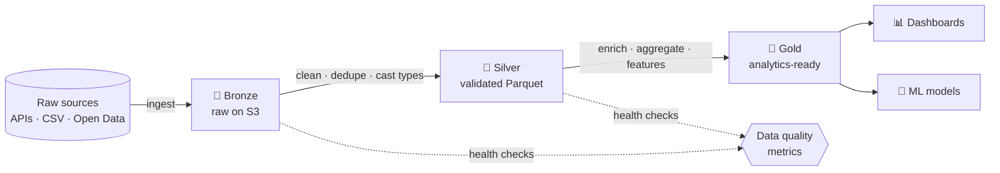

<!-- ================= HEADER (animated 3D SVG, see assets/banner.svg) ================= -->
<p align="center">
  
</p>

<p align="center">
  <a href="https://git.io/typing-svg">
    
  </a>
</p>

<p align="center">
  
  
  
  
</p>

---

## 👋 About me

I'm **Samuel**, a **Systems Engineer from EAFIT University** focused on **Data Engineering**.
I design and build data pipelines that take messy, raw data and turn it into clean, trusted datasets ready for analytics and machine learning.

```python
class DataEngineer:
    name     = "Samuel Acosta"
    location = "Medellín, Colombia 🇨🇴"
    focus    = ["Batch pipelines", "Medallion architecture", "Data quality", "Cloud data platforms"]
    stack    = {
        "processing": ["PySpark", "Pandas", "SQL"],
        "cloud":      ["AWS Glue", "S3", "Lambda", "RDS"],
        "platforms":  ["Databricks", "GCP Dataproc"],
        "serving":    ["Streamlit", "FastAPI", "Plotly"],
    }
    mindset  = "If it isn't tested, monitored and documented, it isn't production-ready."
```

- 🏗️ Building **Bronze → Silver → Gold** pipelines with **AWS Glue + PySpark** on **S3**
- 🧪 Obsessed with **data quality**: nulls, duplicates, outliers and schema drift are measured, not guessed
- ⚡ Background in **serverless backends** (FastAPI + AWS Lambda + RDS), so I care about latency and cost
- 🌱 Contributing to **open source data tools**, and always happy to collaborate

---

## 🔄 How I build pipelines



---

## 🚀 Featured data projects

<table>
  <tr>
    <td width="50%" valign="top">
      <h3>🗽 NYC 311 · Medallion Data Pipeline</h3>
      <p>End-to-end pipeline over the NYC 311 service-request dataset. <b>AWS Glue (PySpark)</b> jobs move data from <b>Bronze → Silver → Gold</b> on <b>S3</b>, with health-check jobs that track nulls, duplicates and outliers per layer, plus feature enrichment for an ML model and a live quality dashboard.</p>
      <p>
        
        
        
        
      </p>
      <a href="https://github.com/SaraCmque/ny311_ds_project">📁 Code</a> · <a href="https://ny311dsproject.streamlit.app/">🌐 Live dashboard</a>
    </td>
    <td width="50%" valign="top">
      <h3>🏭 Decision Support System · Data Integration</h3>
      <p>Integrates three deliberately inconsistent sources (<b>inventory, logistics and customer feedback</b>) into a single model. Cleans type errors, outlier costs ($0.01 → $850k) and negative stock, then answers 5 business questions, including quantifying <b>17.44% of revenue at risk</b> from untracked inventory.</p>
      <p>
        
        
        
      </p>
      <a href="https://github.com/sacostaa1/challenge02-data-science">📁 Code</a> · <a href="https://challenge02-data-science-tikjhs9mnzqrgvwb4amsno.streamlit.app">🌐 Live app</a>
    </td>
  </tr>
  <tr>
    <td width="50%" valign="top">
      <h3>📡 IoT & Infrastructure Analytics Audit</h3>
      <p>Audit of agricultural and energy sensor data in Eastern Antioquia: denoising IoT signals (FFT, Butterworth filters), graph analysis to find single points of failure, and time-series forecasting (ADF, Granger, SARIMAX).</p>
      <p>
        
        
        
      </p>
      <a href="https://github.com/SaraCmque/DS-Challenge3">📁 Code</a>
    </td>
    <td width="50%" valign="top">
      <h3>☁️ Data Storage & Processing Labs</h3>
      <p>Hands-on labs across platforms: <b>S3</b> data lakes, <b>SQL</b>, <b>Spark medallion</b> pipelines, a <b>Glue Bronze → Silver</b> job, <b>Databricks ETL</b> and <b>GCP Dataproc</b>.</p>
      <p>
        
        
        
      </p>
      <a href="https://github.com/sacostaa1/almacenamiento_procesamiento_03_2026">📁 Code</a>
    </td>
  </tr>
</table>

---

## 🧰 Data stack

<p align="center"><b>Languages & processing</b></p>
<p align="center">
  
</p>
<p align="center">
  
  
  
  
  
</p>

<p align="center"><b>Cloud & data platforms</b></p>
<p align="center">
  
  
  
  
  
  
</p>

<p align="center"><b>Serving, visualization & tooling</b></p>
<p align="center">
  
  
  
  
  
  
</p>

<p align="center"><b>🎯 Next on my roadmap</b></p>
<p align="center">
  
  
  
  
</p>

---

## 📊 My contributions in 3D

<p align="center">
  <picture>
    <source media="(prefers-color-scheme: dark)" srcset="./profile-3d-contrib/profile-night-rainbow.svg" />
    <source media="(prefers-color-scheme: light)" srcset="./profile-3d-contrib/profile-gitblock.svg" />
    
  </picture>
</p>

---

## 🤝 Let's build together

I'm actively looking to **collaborate on open source data projects** (pipelines, data quality, Spark, AWS tooling) and to connect with people in the data community.
Open an issue on any of my repos, or reach out:

<p align="center">
  <a href="mailto:samuelacostaaristizabal1@gmail.com"></a>
  <a href="https://github.com/sacostaa1"></a>
</p>

<p align="center">
  🌎 Spanish (native) · English · Portuguese (learning)
</p>

<p align="center">
  
</p>
