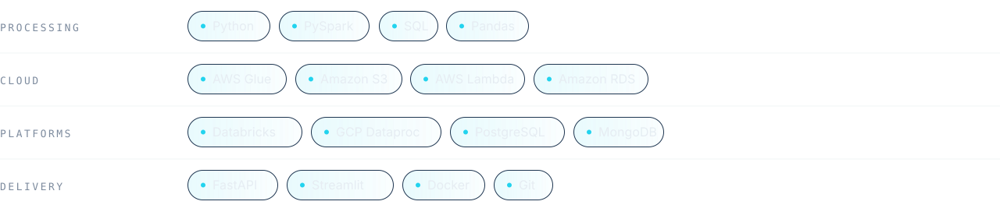

  

 

I'm a **Data Engineer** based in Medellín, Colombia. I build pipelines that turn raw, messy data into datasets people can trust, and I care as much about how data is validated as about how it moves.

I believe the best data tooling is built **in the open**. That's where I spend my time: learning from the community, contributing back, and sharing what I build along the way.

 

  

 

  

 

Working on an open source data project, or want a second pair of hands on a pipeline? I'd like to hear about it.

  &nbsp;
  

Spanish (native) · English · Portuguese (learning)

  

  

